  

&nbsp;&nbsp;&nbsp;
&nbsp;&nbsp;&nbsp;

 

## Sobre

Desenvolvedor back-end júnior · São Paulo, Brasil

Trabalho com Node.js e TypeScript. Atuo em um ERP multi-loja em produção, responsável pelas integrações com Shopee, TikTok Shop e Mercado Livre. Cursando Análise e Desenvolvimento de Sistemas na UNINTER (conclusão prevista em agosto de 2027) e estudando Java.

Em busca de uma vaga de desenvolvedor back-end júnior.

## Stack

## Projetos em destaque

&nbsp;

- **[Smart Triage API](https://github.com/jonethon5/smart-triage-api)**: triagem de tickets de suporte com classificação por IA (Gemini), autenticação JWT, PostgreSQL, Docker e CI. A IA foi avaliada contra um gabarito próprio: 78,6% de acerto na categoria em 14 tickets, com erros e limites documentados.
- **[Stock Ledger API](https://github.com/jonethon5/stock-ledger-api)**: controle de estoque com transações e `SELECT ... FOR UPDATE`, validado com teste de 50 débitos simultâneos.
- **[Portfólio](https://jonethon-portfolio.vercel.app)**

## Estatísticas

  

