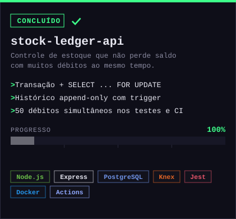
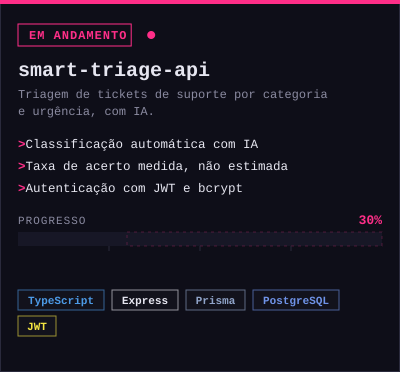

  

&nbsp;&nbsp;&nbsp;
&nbsp;&nbsp;&nbsp;

 

## Sobre

Desenvolvedor backend com experiência desde jan/2026 em Node.js e Express, em um ERP multi-loja em produção, com integrações via API com Shopee, TikTok Shop e Mercado Livre (OAuth, webhooks e jobs agendados). Atuo com MySQL e PostgreSQL, testes com Jest, Docker e CI/CD com GitHub Actions.

Estudante de Análise e Desenvolvimento de Sistemas na UNINTER, com previsão de conclusão em ago/2027. Inglês avançado.

  

## Projetos em destaque

&nbsp;

## Estatísticas

  

🇺🇸 Read in English

## About me

Backend developer working with Node.js on a multi-store ERP in production: marketplace API integrations (Shopee, TikTok Shop and Mercado Livre), relational database modeling, Docker environments and a CI/CD pipeline with GitHub Actions. Studying Systems Analysis and Development at UNINTER (expected graduation: Aug 2027). Advanced English.

## Highlights

- Deploy time reduced from 10-15 minutes to under 1 minute with a GitHub Actions pipeline.
- Shopee ADS budget scheduling automated across 11 stores, replacing a manual process repeated up to 9 times a day.
- Stock Ledger API: concurrency-safe stock control with append-only audit trail (PostgreSQL), tested with 50 simultaneous debits.

